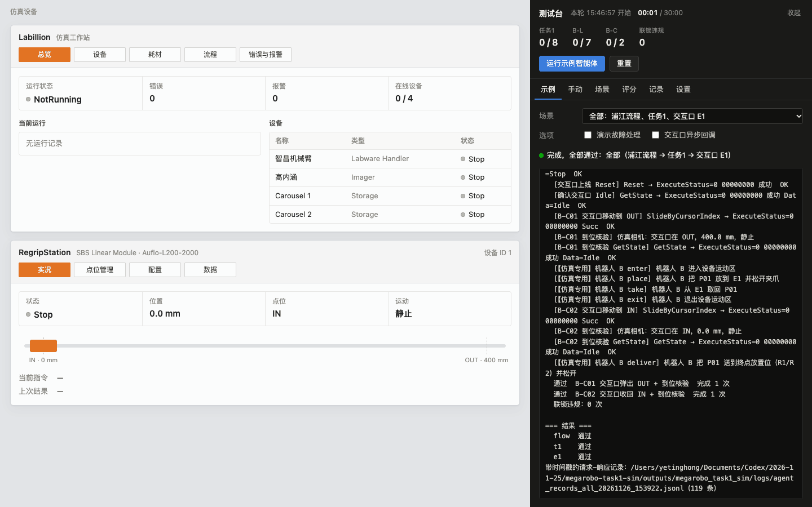
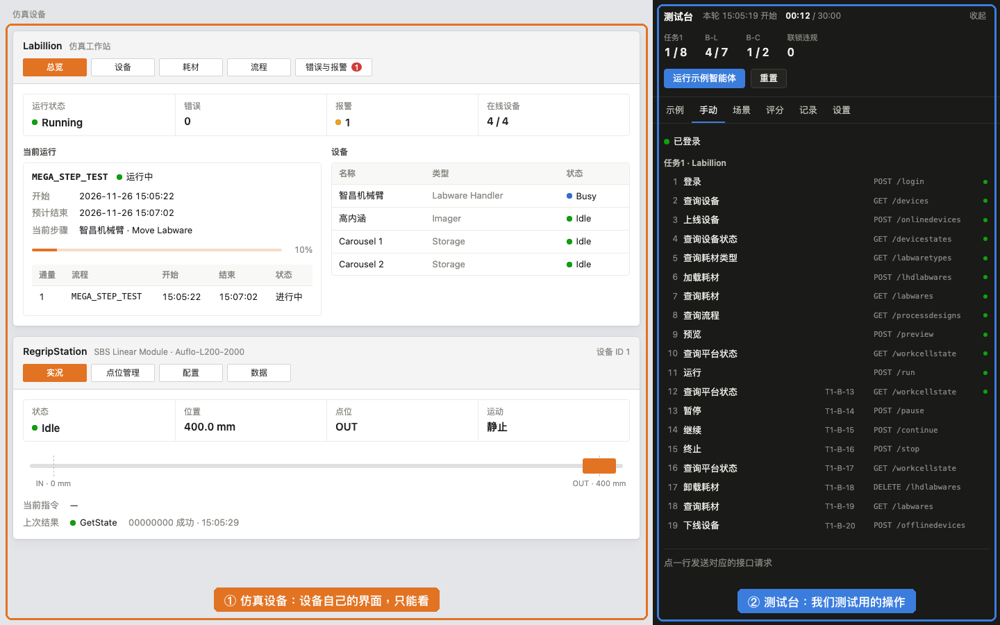
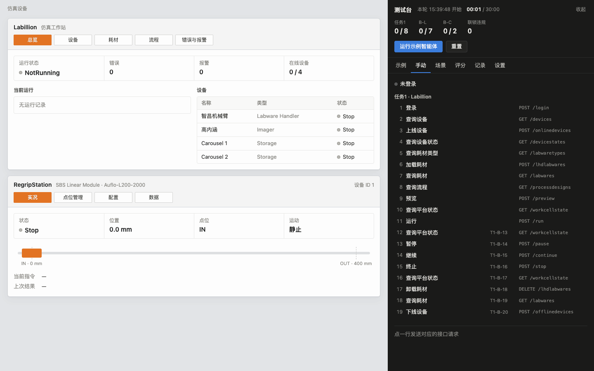

# 镁伽设备仿真台

手边没有镁伽设备时，用它来调试智能体。

它在电脑上模拟两台镁伽设备：

- **Labillion 平台**：任务1 要调用的 19 个接口，包括登录、上线、耗材、预览、运行、暂停、继续、终止、卸载、下线、报警、容错。
- **交互口 E1 的滑轨**：NUC 驱动接口，包括上线、弹出、收回、暂停、继续、终止、重试、忽略、查状态。

你的智能体像连真设备一样连它，它按镁伽接口文档的格式回复。页面上能看到设备状态、自动判分，以及每一次请求和回复。



## 能做什么

- **接口和文档一致**：Labillion 19 个接口；滑轨 9 条指令，同步、异步回调都支持。逐条对照见 [接口对照表.md](接口对照表.md)。
- **按评分表自动判分**：任务1 的 T1-B-13 ~ 20，任务3 的 B-L01 ~ 07、B-C01 / 02。
- **能制造故障**：流程出错、报警、接口超时、服务端错误、平台维护，滑轨中途报错、卡住、没到位、急停。用来看智能体会不会处理。
- **自带示例智能体**：点一下按钮，看完整流程怎么跑。

## 使用流程

### 1. 安装和启动

需要 Python 3.9 或更新版本。在这个文件夹里打开终端，一行一行执行（Windows 把 `python3` 换成 `python`）：

```bash
python3 -m pip install -r requirements.txt
python3 sim_server.py
```

浏览器会自动打开 http://127.0.0.1:8090 。终端窗口不要关，按 Ctrl+C 退出。

### 2. 认识页面



- **左边：仿真设备**。模拟设备自己的界面，只能看、不能点。Labillion 显示平台状态、当前运行、设备、耗材、错误与报警；RegripStation 显示滑轨的状态、位置和收到的指令。
- **右边：测试台**。给我们测试用的，真设备上没有：运行示例、手动发请求、重置、制造故障、看评分和记录。点“收起”可以只看左边。

### 3. 看一遍示例

点测试台顶部的 **运行示例智能体**。示例智能体依次跑三段：浦江调用流程、任务1、交互口弹出和收回，大约 20 秒。左边的设备状态跟着变，测试台顶部的分数涨到 任务1 8/8、B-L 7/7、B-C 2/2。

### 4. 自己一步一步试

打开测试台的 **手动** 标签页，按 1 → 19 的顺序点。每点一行，就真的向设备发一次请求，下面显示设备的回复。对应的检查点得分后，这一行末尾会出现绿点。



### 5. 接你们自己的智能体

让智能体连下面两个地址。参数都在测试台的“设置”页里，也在 `config.json` 里。

| 项 | 怎么填 |
|---|---|
| Labillion 接口 | `http://<电脑IP>:8080/api/automation/v1/<接口名>` |
| 滑轨接口 | `POST http://<电脑IP>:40000/api/BusFrame/System/Post`，`DeviceId` 填 `"1"` |
| 每个请求都要带的请求头 | `Content-Type: application/json`、`Accept-Language: zh-CN`、`Platform: <config.json 里的 platform>`；登录后再加 `Authorization: Bearer <token>` |
| 登录 | `POST /login`，账号是 `config.json` 里的 tenantId、userName、password；回复里的 `data` 就是 token |
| 任务1 的流程 | `POST /run`，`runName` 和 `process` 都填 `MEGA_STEP_TEST` |
| 滑轨点位 | `CursorIndex` 0 = 收回（IN），1 = 弹出（OUT，交互位 E1） |
| 滑轨异步回调 | 结果发到 `http://<智能体IP>:9100/api/OnResponse`（成功）或 `/api/OnError`（失败） |

最小例子：

```python
import requests

B = "http://127.0.0.1:8080/api/automation/v1"
H = {"Content-Type": "application/json", "Accept-Language": "zh-CN",
     "Platform": "5e2c7a91-3f4b-4d8e-a6c0-9b1d2f7e8a43"}
login = {"tenantId": "1000000000000000001", "userName": "agent@example.com", "password": "sim123456"}
H["Authorization"] = "Bearer " + requests.post(f"{B}/login", headers=H, json=login).json()["data"]
print(requests.get(f"{B}/workcellstate", headers=H).json())
```

两台设备都有网页版接口说明，可以直接在网页上试：http://127.0.0.1:8080/docs 、http://127.0.0.1:40000/docs 。

### 6. 重来

点 **重置**：设备全部下线、测试耗材清空、流程停止，任务1 计时从 0 开始。

## 文件

| 文件 | 是什么 |
|---|---|
| `sim_server.py` | 仿真台本体。一个程序开三个端口：8080 是 Labillion，40000 是滑轨，8090 是页面 |
| `dashboard.html` | 页面 |
| `demo_agent.py` | 示例智能体。也能在终端单独跑：`python3 demo_agent.py all` |
| `config.json` | 账号、端口、设备、耗材、流程、滑轨点位 |
| `接口对照表.md` | 每个接口在文档第几页、文档写了什么、仿真实际回了什么 |
| `详细说明.md` | 判分规则、仿真的时间和行为、文档没写清的地方怎么处理、每个配置项 |

## 注意

- `config.json` 里的 Platform、账号、设备、流程都是假的占位值。比赛前换成主办方给的“统一连接配置和已冻结登记的参数”。
- 接口文档有二十多处没写清或前后矛盾，比如成功码到底是 0 还是 200。仿真先按一种理解做了，都列在 [详细说明.md](详细说明.md) 里，需要找主办方或镁伽确认。
- 三份接口文档（PDF）是镁伽和主办方的资料，其中 NUC 驱动文档写明“版权所有”，所以没有放进仓库，请向主办方索取。
